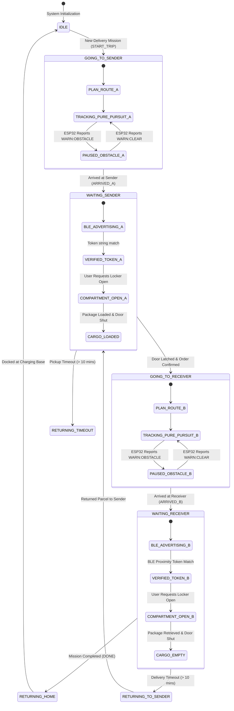

# Autonomous Delivery Robot (AGV) & IoT Fleet Dispatch Platform

[%20%2B%20ESP32%20RTOS-blue?style=for-the-badge)](#2-system-architecture)
[](#5-embedded-software-engineering)
[](#4-engineering-design-decisions--trade-offs)
[](#9-build-flash--deployment-guide)

---

## Table of Contents
1. [System Overview](#1-system-overview)
2. [System Architecture](#2-system-architecture)
3. [Hardware Architecture & Electrical Diagram](#3-hardware-architecture--electrical-diagram)
4. [Engineering Design Decisions & Trade-offs](#4-engineering-design-decisions--trade-offs)
5. [Embedded Software Engineering](#5-embedded-software-engineering)
6. [Finite State Machines](#6-finite-state-machines)
7. [End-to-End Operational Workflow](#7-end-to-end-operational-workflow)
8. [Hardware Wiring & Pin Mapping](#8-hardware-wiring--pin-mapping)
9. [Build, Flash & Deployment Guide](#9-build-flash--deployment-guide)
10. [Source Code Structure & Git Conventions](#10-source-code-structure--git-conventions)

---

## 1. System Overview

> Source status: active firmware uses nominal 50 Hz control with blocking ToF, single-channel encoders and dynamic heap allocation. Madgwick/IMU fusion is not integrated. Navigation smoothing is linear interpolation plus moving average, not cubic spline. Hardware performance and physical wiring are not verified by code review. See [Vietnamese audit](robot/docs/embedded-audit.md) and [study guide](robot/docs/embedded-study-guide.vi.md).

Future work, not implemented by this patch: integrate calibrated IMU/compass data into Madgwick and telemetry, verify encoder direction/overflow, and improve sensor scheduling and navigation validation after hardware measurements.

This project develops an autonomous, weather-resistant **Outdoor Autonomous Delivery Robot (AGV)** ecosystem engineered for contactless last-mile logistics within university campuses and corporate complexes:

1. **Client & Fleet Ecosystem:** Native **Android Application** for senders/receivers (order booking, live GPS route tracking, contactless proximity locker opening via BLE) and **Web Fleet Management Dashboard** (React 18 + Leaflet Map) for real-time fleet telematics and mission dispatching.
2. **High-Level Navigator (Raspberry Pi 4):** Manages global GNSS positioning (U-blox Neo-M8N), trajectory smoothing via **linear interpolation + moving average**, path tracking using **Pure Pursuit**, bidirectional MQTT telemetry over 4G-LTE/WiFi, and mission lifecycle orchestration.
3. **Real-Time Motion & Security Controller (ESP32 Dual-Core):** Executes **FreeRTOS** tasks pinned to two cores, nominal 20 ms velocity PID with integral clamping, and blocking VL53L0X ToF safety checks (Madgwick is declared but not updated), and a local **BLE GATT Security Server**.

---

## 2. System Architecture

```
+---------------------------------------------------------------------------------------+
|                                    CLOUD & CLIENT TIER                                |
|  +--------------------------------+               +--------------------------------+  |
|  |     Android Mobile App         |               |     Web Fleet Dashboard        |  |
|  |     (Kotlin / Java)            |               |     (React 18 + Vite + Leaflet)|  |
|  |  - Order Dispatch & Token String|               |  - Real-Time AGV Telemetry Map |  |
|  |  - Live GPS Navigation Feed    |               |  - Centralized Fleet Dispatch  |  |
|  |  - Proximity 2-Step BLE Unlock |               |  - System Health & Event Logs  |  |
|  +----------------+---------------+               +----------------+---------------+  |
+-------------------|------------------------------------------------|------------------+
                    | HTTPS / WebSocket                              | REST / MQTT
+-------------------v------------------------------------------------v------------------+
|                             CLOUD BROKER & BACKEND LAYER                              |
|  - Firebase Realtime Database (Order state synchronization & global GPS telemetry)    |
|  - Node.js (Express) Gateway Service (REST API bridge & Mosquitto MQTT Broker)        |
+-------------------------------------------+-------------------------------------------+
                                            | MQTT over 4G-LTE / WiFi
                                            | Topics: agv/orders/pending, agv/commands, agv/location
+-------------------------------------------v-------------------------------------------+
|                        ROBOT HIGH-LEVEL CONTROLLER (RASPBERRY PI 4)                   |
|  +---------------------------------------------------------------------------------+  |
|  | [Navigation Core] Pure Pursuit Path Tracking & Linear/Moving-Average Smoothing   |  |
|  | [Sensor Fusion] Extended Kalman Filter fusing GPS + Wheel Odometry + Yaw IMU   |  |
|  | [Lifecycle FSM] Order Lifecycle Manager (GOING_TO_A -> ARRIVED_A -> B...)       |  |
|  | [Network Manager] Resilient MQTT Client with auto-reconnect & packet caching   |  |
|  +----------------------------------------+----------------------------------------+  |
+-------------------------------------------|-------------------------------------------+
                                            | Full-Duplex USB-UART Serial (115200 bps)
                                            | Protocol: SPEED:vL:vR, ODO:tL:tR, WARN...
+-------------------------------------------v-------------------------------------------+
|                     ROBOT LOW-LEVEL REAL-TIME CONTROLLER (ESP32)                      |
|  +---------------------------------------------------------------------------------+  |
|  |                     FREERTOS DUAL-CORE MULTITASKING SCHEDULER                   |  |
|  |                                                                                 |  |
|  |  [CORE 0: Asynchronous & Connectivity]  |  [CORE 1: Control task, nominal 20 ms]       |  |
|  |  - UART Packet Stream Parser from Pi 4  |  - Dual Motor Closed-Loop PID Loop    |  |
|  |  - BLE GATT Server (2-Step Offline Auth)|  - Single-channel PCNT pulse counting   |  |
|  |  - Servo Door & Limit Switch   |  - IMU/Compass: not integrated |  |
|  |                                         |  - VL53L0X Laser ToF Scan (<30cm Stop)|  |
|  |                                         |                                       |  |
|  |  <====== Synchronized via FreeRTOS Mutex (Thread-Safe Shared Telemetry) ======>  |  |
|  +---------------------------------------------------------------------------------+  |
+---------------------------------------------------------------------------------------+
```

---

## 3. Hardware Architecture & Electrical Diagram

The electrical power distribution tree isolates high-current actuator transients from delicate computation processors:

```
                          [ 12V / 24V 10Ah LI-ION BATTERY PACK ]
                                          |
                      +-------------------+-------------------+
                      | (12V/24V Actuator Power Rail)         | (12V Logic Supply)
                      v                                       v
         +--------------------------+            +--------------------------+
         | HIGH-POWER MOTOR DRIVER  |            | DC-DC BUCK 5V / 4A       |
         | (L298N dual motor driver (code))  |            | (Raspberry Pi Power Rail)|
         +-------------+------------+            +------------+-------------+
                       |                                      | (5V 4A)
         +-------------+-------------+                        v
         | (High-Current PWM)        |               [ Raspberry Pi 4 Model B ]
         v                           v                        |
    [ LEFT MOTOR ]              [ RIGHT MOTOR ]               |-- (USB) --> [ U-blox NEO-M8N GPS ]
    [ + Optical Enc ]           [ + Optical Enc ]             |-- (USB-UART CP2102) ----+
         |                           |                                                  |
         +-------------+-------------+                                                  |
                       | (One rising-edge pulse input per wheel)                                |
                       v                                                                |
         +--------------------------------------------------------------------+         |
         | DC-DC BUCK 5V/3.3V (Dedicated Embedded Microcontroller Rail)       |         |
         +---------------------------------+----------------------------------+         |
                                           | (5V)                                       |
                                           v                                            |
         +--------------------------------------------------------------------+         |
         |                 ESP32 DUAL-CORE RTOS CONTROLLER                    |<--------+
         |                                                                    |
         |--- (Hardware PCNT Unit 0/1) <--- [ Single-channel wheel pulse inputs ]|
         |--- (I2C Fast Mode 400kHz) -----> [ IMU MPU6050 + Compass QMC5883L ]|
         |--- (I2C Fast Mode 400kHz) -----> [ VL53L0X Laser ToF Rangefinder ] |
         |--- (GPIO Output 5kHz PWM) ----> [ L298N Motor Driver Logic ]    |
         |--- (GPIO23 servo output) -----> [ Cargo compartment servo]|
         |--- (GPIO In Pullup) -----------> [ Limit Switch (Door Interlock) ] |
         |--- (2.4GHz RF Antenna) --------> [ BLE 4.2 GATT Proximity Link ]   |
         +--------------------------------------------------------------------+
```

### Electrical verification required
The active firmware configures L298N PWM and a servo, not BTS7960 or a solenoid relay. Physical power rails, isolation, protection, voltage dividers and wiring have not been verified from code.

---

## 4. Engineering Design Decisions & Trade-offs

### Decision 1: Raspberry Pi navigation + ESP32 motion
Pi runs Python mission FSM, NMEA GPS, OSRM route retrieval, linear interpolation/moving average, Pure Pursuit and an EKF implementation. ESP32 handles PCNT, motor PWM, ToF and BLE. Linux and blocking sensor calls mean this architecture alone does not establish hard real-time behavior or jitter limits.

### Decision 2: Two pinned FreeRTOS tasks
`TaskComms`: core 0, priority 1, 10 ms relative delay, telemetry scheduled at 50 ms. `TaskControl`: core 1, priority 2, `vTaskDelayUntil` with nominal 20 ms, including blocking ToF, encoder/PID, servo, battery and buzzer. BLE callbacks run in library-managed tasks. Mutexes protect shared state; priority inheritance mitigates but does not eliminate delays from long critical sections.

### Decision 3: Sensor fusion is incomplete
Madgwick is instantiated but no IMU/compass reads or filter updates exist. IMU/yaw telemetry remains initialized to zero. The Pi EKF has GPS/odometry prediction and correction code but lacks real gyro input from this firmware. No heading accuracy is established.

### Decision 4: Discrete PID with integral clamping
`ClosedLoopPid::compute` uses `I = clamp(I + error, -200, 200)` and `D = error - previousError`; gains absorb the nominal sample interval. It does not implement saturation-aware conditional integration. Motor output is clamped to magnitude 0..255, then signed using the target. Both target and measured pulse rate use ticks/50 ms; delta is normalized by actual elapsed milliseconds. PCNT measures magnitude only; odometry direction is inferred from the preceding output and cannot detect external reverse motion.

### Decision 5: BLE token comparison
The ESP32 compares a supplied string with a cached token under a mutex. Each open action checks the token independently; verification does not create an authenticated session. BLE OFF clears the token even for already connected clients. The firmware does not establish token entropy, cryptographic authentication or a 3 m proximity boundary. GPIO23 drives a servo, not a solenoid relay.

---

## 5. Embedded Software Engineering

* Nominal control period: 20 ms (50 Hz); ranging calls can overrun it. No measured jitter-free behavior or braking latency.
* UART command: `payload*XX\n`, exact two hex CRC-8/0x07/init0. Oversized lines are discarded until newline. SPEED requires exactly two finite values in [-25,25] ticks/50 ms.
* A valid SPEED refreshes a 1000 ms command timeout. The active Pi loop sends approximately every 100 ms; ten missed updates is an engineering margin, not a measured stopping bound. Non-motion commands and invalid frames do not refresh it. Timeout clears targets and resets PID at the next control iteration.
* Invalid ToF status/failed startup holds both motors; a valid range below 300 mm also stops both, including turns/reverse. No 500 ms release hysteresis or soft-start ramp is implemented.
* PCNT uses GPIO16/17, rising-edge only, no direction-control input. Separate delta/odometry baselines survive software clear. Counter saturation or pulses during pause/clear still need hardware validation.
* Dynamic allocation exists: BLE callbacks/descriptors with `new`, `String`, ArduinoJson, tasks and mutexes. Static objects do not imply zero heap.
* UART TX lines share a mutex so event and telemetry output cannot interleave. Door/token/buzzer and speed/telemetry use a data mutex.

---

## 6. Finite State Machines

The diagrams describe conceptual workflows. Actual Python states and servo events should be checked against `robot/pi_master/main.py` and firmware `DoorState`; there is no measured proximity boundary, solenoid driver or active holding brake.

### 6.1. End-to-End Order Lifecycle State Machine (Raspberry Pi 4)



### 6.2. Two-Step Proximity BLE Security Handshake

```mermaid
sequenceDiagram
    autonumber
    actor User as Customer (Mobile App)
    participant BLE as ESP32 (GATT Server)
    participant Pi as Raspberry Pi 4
    participant Lock as Servo

    Note over User,Pi: AGV stops at waypoint & initiates BLE broadcast
    Pi->>BLE: Serial Frame: BLE:ON:<Token_128bit>
    BLE-->>User: BLE Advertisement (AGV_DELIVERY_01)
    
    User->>BLE: Step 1: Send JSON {"action":"verify_token", "token":"..."}
    alt Token Mismatch
        BLE-->>User: Return {"ok":false, "msg":"Invalid Token"}
    else Token Match Verified
        BLE-->>User: Return {"ok":true, "status":"VERIFIED"}
        Note over User: App unlocks "Open Compartment" UI button
    end
    
    User->>BLE: Step 2: User taps button -> {"action":"open_slot", "token":"..."}
    BLE->>Lock: Set servo target to 30 degrees
    BLE->>Pi: Serial Frame: DOOR:OPENED
    
    Note over User,Lock: Package loaded/unloaded; door is closed
    Lock-->>BLE: Limit Switch contacts close
    BLE->>Lock: Set servo target to 100 degrees
    BLE->>Pi: Serial Frame: DOOR:CLOSED
```

### 6.3. Implemented safety behavior
`TaskControl` stops both outputs and resets both PID states when ToF is invalid or below 300 mm, target is zero, or valid SPEED has expired. WARN:OBSTACLE/CLEAR reports sensor hold transitions. A valid clear sensor can release the hold while the SPEED timeout remains enforced. There is no active brake, 500 mm / 500 ms release rule or acceleration ramp.

---

## 7. End-to-End Operational Workflow

### Stage 1: Order Initiation & Dispatch
1. Sender creates a shipment on the Android app, designating receiver dropoff coordinates. The cloud service issues a random token string (generation not audited here) and syncs to Firebase.
2. Raspberry Pi 4 receives dispatch over MQTT, caching the authentication token locally.
3. The **linear interpolation + moving average** algorithm smooths waypoints, and the **Pure Pursuit** controller calculates differential wheel velocity setpoints (`SPEED:vL:vR`).
4. ESP32 runs the 50Hz nominal closed-loop Anti-Windup PID controller to track target velocity.

### Stage 2: Parcel Loading at Sender Location
1. Upon arriving at Point A, Pi 4 stops the vehicle and activates BLE advertising.
2. Sender approaches over BLE; the Android app performs the 2-step BLE authentication handshake.
3. Sender presses "Open Locker"; the servo target changes to 30 degrees. A change in package limit-switch state starts an 8 s closing delay; servo target becomes 100 degrees. DOOR:CLOSED is emitted when the commanded servo angle reaches 100, not from a latch-position sensor.

### Stage 3: Autonomous Transit to Destination
1. BLE advertising is deactivated for security and power conservation.
2. AGV tracks outdoor waypoints via Pure Pursuit, running GPS/encoder EKF code; real IMU/magnetometer input is not yet integrated.
3. VL53L0X ranging is called in the nominal 20 ms control task; actual frequency must be measured. A valid range below 300 mm or invalid measurement causes output cutoff at the control decision; reaction latency and mechanical stopping distance remain unmeasured.

### Stage 4: Parcel Handover to Receiver
1. At Point B, Pi 4 halts the vehicle and reactivates BLE broadcast.
2. Receiver completes the 2-step BLE handshake to retrieve the shipment.
3. Internal optical sensors confirm the locker is empty, and the door is re-locked. Order state transitions to `COMPLETED`.

### Stage 5: Autonomous Return to Home Base
1. The AGV computes the shortest path back to the home charging station.
2. Upon docking, the robot transitions to `IDLE` mode, awaiting subsequent mission dispatch.

---

## 8. Hardware Wiring & Pin Mapping

### ESP32 (Low-Level Motion & Security Controller)
These are configured pins; verify the physical board before flashing.

| Peripheral | Configured pin/function |
|---|---|
| Motor L PWM / DIR | GPIO14, LEDC2; GPIO32/33; 5 kHz, 8 bit |
| Motor R PWM / DIR | GPIO27, LEDC3; GPIO25/26; 5 kHz, 8 bit |
| Encoder L / R | GPIO16 / GPIO17, PCNT0/1 rising edge, one channel each |
| I2C | GPIO21 SDA / GPIO22 SCL; Wire.begin without explicit 400 kHz; ToF integrated, IMU/compass not integrated |
| Servo | GPIO23, 50 Hz; open30 / close100 degrees |
| Limit switch | GPIO5, INPUT_PULLUP; package-state change triggers delayed closing |
| Buzzer / battery ADC | GPIO19 / GPIO36 |
| Pi link | `Serial` UART0 through board USB-UART, 115200; GPIO16/17 are encoders, not Serial2 |

### Raspberry Pi 4 (High-Level Navigator)
| Interface Port | Peripheral Device | Protocol | Technical Specification |
| :--- | :--- | :--- | :--- |
| **USB Port 1** | ESP32 Controller | USB-to-UART CP2102 | Serial telemetry & velocity commands |
| **USB Port 2** | GPS U-blox Neo-M8N | NMEA Serial (115200 default in Python; verify module setting) | Multi-GNSS satellite positioning |
| **Network** | 4G-LTE Modem / WiFi | TCP/IP | MQTT & Firebase Realtime Database |

---

## 9. Build, Flash & Deployment Guide

### Prerequisites:
* [VS Code](https://code.visualstudio.com/) with the [PlatformIO IDE](https://platformio.org/) extension.
* [Python](https://www.python.org/) 3.9+ on Raspberry Pi OS.
* [Node.js](https://nodejs.org/) v18+ for the Web Fleet Dashboard.
* [Android Studio](https://developer.android.com/studio) for the mobile client.

### 9.1. Flashing ESP32 Firmware
```bash
cd robot/arduino_slave
# Compile and flash firmware via USB-UART
pio run --target upload
```

### 9.2. Raspberry Pi Navigator Setup
```bash
cd robot/pi_master
# Create and activate virtual environment
python3 -m venv venv
source venv/bin/activate
pip install -r requirements.txt

# Launch central mission navigator
python3 main.py
```

### 9.3. Launching Web Fleet Dashboard
```bash
# Automated launch script (Windows):
./web/start_web.bat

# Manual launch:
# Terminal 1: Backend Gateway
cd web/backend && npm install && npm start

# Terminal 2: Frontend Web App
cd web/frontend && npm install && npm run dev
```

---

## 10. Source Code Structure & Git Conventions

### Repository Layout
```
Autonomous-Delivery-Robot/
├── AutoDeliveryApp/           # Native Android App (Kotlin) - Booking, GPS feed, BLE unlock
├── robot/
│   ├── arduino_slave/         # ESP32 Firmware (FreeRTOS, nominal 50Hz PID, PCNT, BLE; IMU pending)
│   └── pi_master/             # Python Navigation Core (Pure Pursuit, GPS, Kalman, MQTT)
├── web/                       # Web Fleet Management Dashboard (React 18 + Express + Leaflet)
│   ├── backend/               # Gateway Service, MQTT Broker Client, REST APIs
│   └── frontend/              # Live telemetry map, fleet mission management
└── README.md                  # Comprehensive Technical System Specification
```

### Git Commit Conventions
All commits strictly adhere to the Conventional Commits standard:
* `feat:` Introduces a new feature (`feat(esp32): add Madgwick AHRS filter for orientation fusion`).
* `fix:` Patches a bug (`fix(pi): resolve Pure Pursuit waypoint lookahead overshoot`).
* `docs:` Documentation updates (`docs(readme): add hardware electrical diagram and design decisions in English`).
* `refactor:` Code reorganization without behavioral modifications (`refactor(rtos): modularize dual-core task creation`).

---
*Author: **Phan Le Thanh Nguyen** — Embedded Systems & Automation Engineer.*
